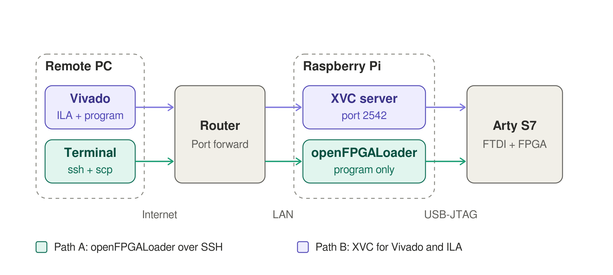

# Remote programming of the Arty S7 with a Raspberry Pi

Two ways to program a Digilent Arty S7 FPGA over the network, using a Raspberry Pi that sits next to the board. You can install both on the same Pi and decide which one you need.

AMD only ships `hw_server` for x86-64, so the usual Vivado remote-programming method does not run natively on a Pi (ARM). These are the two workable alternatives.



|  | Path A: openFPGALoader | Path B: XVC server |
|---|---|---|
| What it does | Command-line tool that writes a bitstream to the board | Forwards JTAG over TCP so Vivado can drive the board |
| Programs the FPGA | Yes (SRAM and flash) | Yes |
| Remote ILA/VIO in Vivado | No | Yes |
| Setup effort | About 15 minutes | Possibly hours (see the caution in Path B) |
| Risk | Low | Medium |

A printable version of this guide is in [`docs/Arty_S7_Remote_Programming_RPi.docx`](docs/Arty_S7_Remote_Programming_RPi.docx).

## Contents

- [Common setup](#common-setup)
- [Path A: openFPGALoader](#path-a-openfpgaloader)
- [Path B: XVC for Vivado and ILA](#path-b-xvc-for-vivado-and-ila)
- [Troubleshooting](#troubleshooting)
- [Which path to pick](#which-path-to-pick)
- [Repository layout](#repository-layout)
- [Sources](#sources)
- [License](#license)

## Common setup

1. Flash Raspberry Pi OS Lite (64-bit) to the Pi and enable SSH with key-based login.
2. On your router, give the Pi a DHCP reservation so its LAN address never changes.
3. Set up a DDNS hostname (DuckDNS or No-IP) for your public IP, and forward one external port to the Pi's SSH port (22).
4. Plug the Arty S7 into the Pi using the board's PROG micro-USB port. Check that the board's power-source jumper is set for USB power (see the Arty S7 reference manual).
5. On the Pi, run `lsusb`. You should see an FTDI device (vendor ID `0403`).

> **Security:** never forward the XVC port (2542) or the `hw_server` port (3121) directly. Neither has authentication. Tunnel them over SSH.

## Path A: openFPGALoader

[openFPGALoader](https://github.com/trabucayre/openFPGALoader) is an open-source command-line programmer that supports the Arty S7. The packaged version on Ubuntu is reported to be old, so build from source on the Pi.

### Install on the Pi

Run the helper script in this repo:

```bash
./scripts/install-openfpgaloader.sh
```

It installs the build dependencies, builds and installs openFPGALoader, installs the udev rules, and adds you to the `plugdev` group. Unplug and replug the board, then log out and back in so the group change applies.

### Test locally on the Pi

```bash
openFPGALoader --detect
```

This should list the Spartan-7 device.

### Program remotely

From your remote machine:

```bash
scp design.bit pi@yourboard.duckdns.org:/tmp/
ssh pi@yourboard.duckdns.org "openFPGALoader -b arty_s7_50 /tmp/design.bit"
```

Or use the helper script, which does both steps:

```bash
./scripts/program-remote.sh pi@yourboard.duckdns.org design.bit
```

- **Board name:** `arty_s7_50` is for the XC7S50 version. For the 25 version, run `openFPGALoader --list-boards | grep arty` to find the name (set it with `BOARD=...`).
- **Flash:** add `-f` (or `FLASH=1` with the script) to write the SPI flash so the design survives a power cycle. Without it the design loads to SRAM only and is lost at power-off.
- **Non-standard SSH port:** add `-P <port>` to `scp` and `-p <port>` to `ssh`, or set `SSH_PORT=<port>` with the script.

## Path B: XVC for Vivado and ILA

> **Caution:** the Arty S7's USB chip is an FTDI part set up for AMD/Digilent tools. XVC needs a third-party server, and the best-known ones target slightly different chips. [`tmbinc/xvcd`](https://github.com/tmbinc/xvcd) is hardcoded for the FT2232C in bitbang mode. [`BerkeleyLab/XVC-FTDI-JTAG`](https://github.com/BerkeleyLab/XVC-FTDI-JTAG) targets generic FT4232H chips. The Arty's chip is, as far as I know, an FT2232H, so it is **not confirmed** that either server runs on the S7 without source edits (USB IDs or channel settings). Try Path A first and use Path B only if you need remote ILA.

### Build the server

```bash
sudo apt install -y git build-essential libusb-1.0-0-dev
git clone https://github.com/BerkeleyLab/XVC-FTDI-JTAG.git
cd XVC-FTDI-JTAG && make
```

Follow that repository's README for the run command and options (not verified here). Run the server by hand once and confirm it opens the FTDI device and listens on TCP port 2542.

### Run it as a service

Edit [`systemd/xvc.service`](systemd/xvc.service) so `ExecStart` points to the real binary and arguments, then:

```bash
sudo cp systemd/xvc.service /etc/systemd/system/xvc.service
sudo systemctl daemon-reload
sudo systemctl enable --now xvc
```

### Tunnel the port over SSH

Run this on your remote machine and leave it open:

```bash
ssh -N -L 2542:localhost:2542 pi@yourboard.duckdns.org -p <forwarded-port>
```

### Connect Vivado

1. Open Vivado and go to Hardware Manager.
2. Click Open Target, then Auto Connect (this creates the local hardware server entry).
3. Right-click `localhost` and choose Add Xilinx Virtual Cable (XVC).
4. Enter `localhost` as the host name and `2542` as the port, then click OK.
5. When the Spartan-7 appears, right-click it and choose Program Device. For ILA, set the probes file (`.ltx`) from your build first.

Programming over XVC can be noticeably slower than a native cable.

## Troubleshooting

| Symptom | What to check |
|---|---|
| Board not detected | Run `lsusb` on the Pi. Use a data-capable USB cable and the PROG port. Re-plug after installing the udev rules. |
| Permission denied from openFPGALoader | Confirm the udev rules file is in `/etc/udev/rules.d/` and that you are in the `plugdev` group (log out and back in). As a test, try with `sudo`. |
| Unknown board name | Run `openFPGALoader --list-boards \| grep arty` and use the exact name. |
| Design lost after power cycle | You loaded to SRAM. Add `-f` to write flash, and check the board's boot-mode jumper in the reference manual. |
| Vivado times out connecting via XVC | Is the SSH tunnel still running? Is the `xvc` service active (`systemctl status xvc`)? Is the server listening on 2542? |
| XVC server cannot open the FTDI device | Likely the chip mismatch described in Path B. Check the USB vendor/product IDs with `lsusb` against what the server expects. |

## Which path to pick

- Choose **Path A** if you just need to push bitstreams to the board remotely. It works with a standard install and little setup.
- Choose **Path B** only if you need ILA or VIO debugging from the Vivado GUI, and accept that you may need to modify the server source.
- Choose an **x86 host** (mini PC or old laptop) running `hw_server` if you want the officially supported route with no compatibility work.

## Repository layout

```
.
├── README.md
├── LICENSE
├── docs/
│   ├── Arty_S7_Remote_Programming_RPi.docx   printable guide
│   ├── block-diagram.png
│   └── block-diagram.svg
├── scripts/
│   ├── install-openfpgaloader.sh             build and install on the Pi
│   └── program-remote.sh                     copy a bitstream and program the board
└── systemd/
    └── xvc.service                           template unit for Path B
```

## Sources

- [openFPGALoader](https://github.com/trabucayre/openFPGALoader) (build, udev rules)
- [Linux install notes (plugdev group, dependencies)](https://wiki.sipeed.com/hardware/en/tang/common-doc/flash-in-linux)
- [MIT 6.205 openFPGALoader guide (`arty_s7_50` board name)](https://fpga.mit.edu/6205/F23b/documentation/openFPGA)
- [tmbinc/xvcd](https://github.com/tmbinc/xvcd)
- [BerkeleyLab/XVC-FTDI-JTAG](https://github.com/BerkeleyLab/XVC-FTDI-JTAG)
- [Vivado XVC connection steps (example)](https://www.emb4fun.de/fpga/xvcd/index.html)

## License

[MIT](LICENSE) © 2026 Edwin Marte Zorrilla
